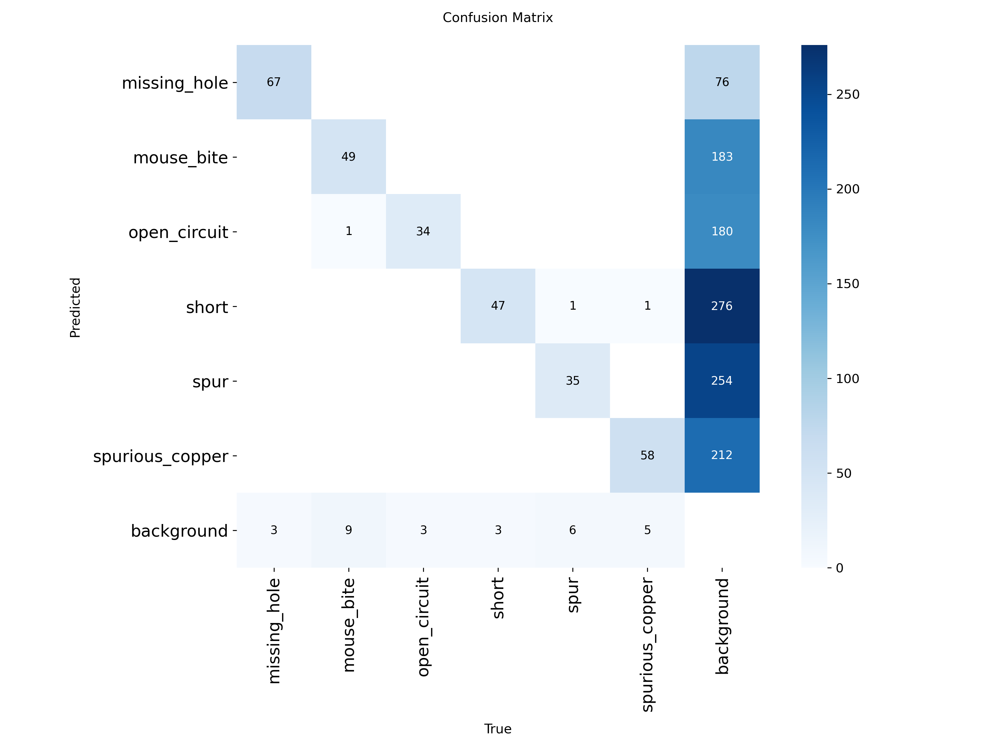
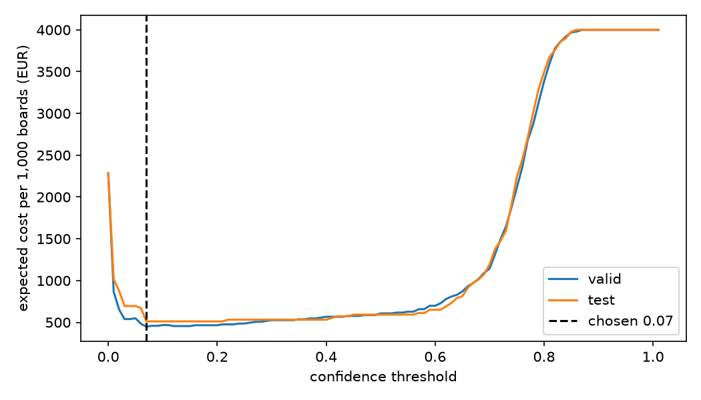

# Assignment 2 Report
 
- **Name**: Sofía Serantes
- **Student ID**: 19523
- **Email**: sserantes.ieu2022@student.ie.edu
- **Group**: BBADBA 5A

## Business problem, and the cost of being wrong
 
**Decision.** For each inspection image of a printed circuit board (PCB) coming off the line, the system decides: pass, fail, or send for human review. The unit of decision is one inspection image, because the dataset images appear to be crops of boards, so I make no claim about whole boards. The positive class is "the image contains at least one defect".
 
**Who acts.** A quality inspector checks each flagged image by hand, which takes about 5 minutes. If the board is fine, it goes back on the line. If it is really defective, it is repaired. If a defective board is missed, it ships, the customer finds the fault, and we replace it, which may also damage the relationship with the customer.
 
**The asymmetry.** A missed defect (false negative) costs about 100 times a false alarm (false positive): EUR 200 against EUR 2.08, a ratio of about 96. A false alarm is caught by an inspector, who looks at the board and puts it back on the line, so it costs about EUR 2. A miss is corrected by nobody before the board ships, so it costs about EUR 200: the board has already left the factory, and we pay for the replacement, the shipping and customer support, and we may harm the relationship with the customer.
 
**What this means for the threshold and the review.** Because a false alarm costs about EUR 2 and a miss about EUR 200, it is cheaper to flag a board that turns out to be fine than to let a defective one ship, so the model should be eager to flag, which means a low threshold. The cost of that eagerness is the inspectors' workload: every flagged board takes about 5 minutes, and having a person check all 2,000 boards a day would need about 24 inspectors, against the 2 I assume are available. To keep the workload feasible I use two thresholds. Boards scoring below the lower threshold pass, boards scoring above the upper threshold are failed automatically without a human check, and only the uncertain boards in between go to an inspector. The final values are: pass below 0.07, automatic fail at 0.78 or above, and about 4.6% of production boards (at an assumed 2% defect rate) go to a person.
 
All figures are my assumptions, kept in `costs.json`:
 
| Outcome | What happens | Cost (EUR) |
|---|---|---|
| True negative | good board passes | 0 |
| False positive | inspector checks a good board for 5 min | 2.08 (25 EUR/h × 5 min) |
| True positive | inspector checks, then board is repaired | 12.08 (2.08 + 10 repair) |
| False negative | defective board ships: 50 replacement + 20 shipping + 30 support + 100 relationship | 200 |
| Good board failed automatically | goes straight to repair, nothing found | 10 |
 
Where each figure came from:
- **Inspector, 25 EUR/hour.** Eurostat reports 26.4 EUR average hourly labour cost in Spain for 2025, including social contributions. This is an all-economy average, not specific to inspectors, so it is a rough anchor.
- **Repair, 10 EUR.** About 20 minutes of technician time at 25 EUR/h is about EUR 8.30, plus about EUR 1.50 of solder and parts.
- **Replacement, 50 EUR.** My guess at the cost of a mid-range industrial board.
- **Shipping 20 and support 30.** Rough guesses with no source.
- **Relationship, 100 EUR.** I assumed a 5% chance of losing a customer worth 2,000 EUR (0.05 × 2,000). Both numbers are my own guesses, with no data behind them. This is the least certain figure in the table, which is why the sensitivity analysis below tests it.
- **Automatic fail of a good board, 10 EUR.** The board skips the inspector but still goes to a technician who finds nothing, so it costs the same as a repair.
- **Base rate, 2%.** My assumption for a mature line, where only a few percent of boards are defective.

## Dataset
 
- Roboflow Universe: workspace `university-of-strathclyde-m436x`, project `pcb-defect-94yfu`, **version 1**.
- Link: https://universe.roboflow.com/university-of-strathclyde-m436x/pcb-defect-94yfu/dataset/1
- License CC BY 4.0, used as published and not forked.
- One image is 640×640 and appears to be a crop of a printed circuit board, with a box drawn around each defect. The six classes are missing_hole, mouse_bite, open_circuit, short, spur and spurious_copper.
- Preprocessing: auto-orient and resize to 640×640 (stretch). The export notes mention augmentation, but the list of augmentations is blank. From the file names, each source image appears about 4 times; I did not check how the copies differ.
- Why it serves my problem: the labels are the defect types an inspector looks for. It resembles production only in appearance: 67% of test images contain a defect, and the test images come from only 69 sources, each appearing 4 times. I did not verify whether the copies are augmentations.

## What the dataset's composition implies
 
| Split | Images | Instances | Images with no defect |
|---|---|---|---|
| train | 5,810 | 7,214 | 1,758 (30%) |
| valid | 556 | 642 | 184 (33%) |
| test | 276 | 322 | 90 (33%) |
 
| Class | train | valid | test |
|---|---|---|---|
| missing_hole | 1,099 | 116 | 70 |
| mouse_bite | 1,266 | 86 | 59 |
| open_circuit | 1,153 | 101 | 37 |
| short | 1,329 | 92 | 50 |
| spur | 1,199 | 115 | 42 |
| spurious_copper | 1,168 | 132 | 64 |
 
- **Balance.** Classes are fairly balanced in every split.
- **Object size.** The median defect is about 4–6% of the image side (roughly 25–40 pixels at 640×640), so the objects are small.
- **Leakage check.** I compared source file names across splits, and no source image appears in more than one. Test comes from only 69 distinct sources, each appearing 4 times, and valid from 139.
- **Too thin to trust.** Test has only 37–70 instances per class, and open_circuit (37) and spur (42) are the smallest. Because each source appears 4 times, the number of independent defects is lower: if the copies show the same defect, 37 instances may be only about 9 distinct ones. Per-class differences of a few points on this split are therefore not reliable.
- **Test does not look like production.** About 67% of test images contain a defect (186 of 276), while I assume 2% of boards are defective. Recall and false-alarm rate do not depend on that base rate, which is why the costing re-weights them to 2%.
- **Empty-label images.** The 90 test images with no defect label may be crops of boards that do have a defect elsewhere.
- **What I therefore cannot conclude.** Anything about whole boards, about new board designs, about false-alarm rates at a 2% defect rate, or about small differences between classes.

## Finetuning and baselines
 
**Model and task.** I finetuned yolo11n, starting from the COCO-pretrained checkpoint, as an object detector, because the dataset has bounding boxes and the defects need to be located.
 
**Why yolo11n.** Claude suggested yolo11n, and I kept it because it is small and cheap: my full training took about 38 minutes on a free Colab GPU, and it runs on my laptop at about 18 ms per image including post-processing. I did not compare it with yolo11s, so I do not know whether a larger model would do better.
 
**Training.** Google Colab, Tesla T4 GPU, about 38 minutes. 30 epochs (early stopping did not trigger), batch size 16, image size 640, early-stopping patience 10, seed 0. Ultralytics chose the optimizer automatically (AdamW, learning rate 0.001). The best checkpoint on the validation split is saved as `weights/best.pt`. The test split was not used to train or to choose any threshold.
 
**Results on the same test split** (276 images, 186 with at least one defect and 90 without):
 
| | Detection (box level) | Image level: AUROC | Defective images flagged at confidence 0.25 | Good images wrongly flagged |
|---|---|---|---|---|
| Fine-tuned yolo11n | AP50 0.875, mAP50-95 0.493, recall 0.849 | 0.965 | 175 of 186 (94%) | 3 of 90 (3%) |
| COCO model, zero-shot | not meaningful: its classes (person, car...) are not PCB defects | 0.502 | 50 of 186 (27%) | 14 of 90 (16%) |
| Predict nothing | 0 | not applicable | 0 of 186 | 0 of 90 |
 
**COCO zero-shot.** The pretrained COCO model's image-level AUROC is 0.502, which means its top-box score ranks defective images above good ones no better than chance (0.5 is a coin flip, 1.0 is perfect). It has no useful knowledge of PCB defects, which is expected because none of its 80 classes are defects. It also wrongly flags 14 of the 90 good test images (16%), compared with 3 (3%) for my model.
 
**Predict nothing.** Predict nothing never raises a false alarm, but it also detects nothing: it misses all 186 defective test images, so every defective board would ship. At a 2% defect rate it would cost about EUR 4,000 per 1,000 boards, against EUR 501 for my model with human review.
 
**Verdict.** My fine-tuned model beats both baselines: it flags 175 of 186 defective test images (94%) against 50 (27%) for COCO and 0 for predict nothing, with 3% false alarms against 16%, and its AUROC is 0.965 against 0.502. The gap was larger than I expected because COCO's AUROC of 0.502 shows it has no usable signal for PCB defects, and fine-tuning on 5,810 training images was enough to separate defective from good images very well. But COCO was a weak baseline, and the test set comes from the same dataset and style as the training data (no source image is shared, but the boards may look alike). So I read this as proof that fine-tuning works, not as proof that 0.965 will hold in production.
 
## Per-class evaluation and failure modes
 
Positive class for the cost analysis: "the image has at least one defect". For detection, each of the six defect types is its own class.
 
| Class | Test instances | Precision | Recall | AP50 | mAP50-95 |
|---|---|---|---|---|---|
| missing_hole | 70 | 0.995 | 0.943 | 0.953 | 0.574 |
| mouse_bite | 59 | 0.989 | 0.814 | 0.835 | 0.480 |
| open_circuit | 37 | 0.934 | 0.865 | 0.910 | 0.501 |
| short | 50 | 0.925 | 0.880 | 0.871 | 0.466 |
| spur | 42 | 0.934 | 0.738 | 0.801 | 0.448 |
| spurious_copper | 64 | 0.932 | 0.858 | 0.881 | 0.486 |
| **All** | 322 | 0.951 | 0.849 | 0.875 | 0.493 |
 

 
- **Carrying the headline.** missing_hole is the strongest class (AP50 0.953, recall 0.943). The overall AP50 of 0.875 is the unweighted mean of the six class values, so missing_hole lifts it through its high score, not through its number of instances.
- **Dragging it down.** spur has the lowest recall (0.738) and AP50 (0.801), followed by mouse_bite (recall 0.814). I have not tested why. One possible explanation is that thin features like these look similar to normal copper traces, but this is a hypothesis, and with only 42 and 59 test instances the gap is suggestive, not proven.
- **What it confuses with what.** In the confusion matrix, almost nothing is confused between defect types: only 3 cross-class errors in total. The failures are defects missed (predicted as background): 29 of 322 instances, most for mouse_bite (9) and spur (6).
- **Background column.** I called `val()` without setting a confidence threshold, so Ultralytics used its default of 0.001. The matrix therefore contains 1,181 boxes on background, almost all of them low-confidence. These should not be read as the model inventing 1,181 defects at a real operating threshold.
- **Gap between AP50 and mAP50-95** (0.875 vs 0.493): the model finds defects far more reliably than it draws tight boxes, which is expected for 25-40 px objects.

## Cost matrix and operating point
 
Costs and base rate are as in the table above (2% defective, miss = EUR 200, false alarm = EUR 2.08).
 

 
- **Single threshold, chosen on valid:** 0.07. On test it gives 176 true positives, 3 false alarms and 10 misses, an expected cost of about EUR 512 per 1,000 boards. (Out of 186 defective test images, 10 are missed.)
- **Why so low.** A miss costs about 100 times a false alarm (200 / 2.08 is about 96), so the minimum sits where the model flags almost anything that looks slightly suspicious.
- **Sensitivity.** The threshold is stable at 0.07 to 0.12 across a missed-defect cost from EUR 50 to EUR 800 (x0.25 to x4), and across base rates from 0.5% to 10% (0.06 to 0.12). So the choice of threshold is robust. What moves is the total cost: it scales strongly with the missed-defect cost (EUR 350 at x0.25, EUR 1,157 at x4) and the base rate (EUR 180 at 0.5%, EUR 2,427 at 10%).
- **The assumption that would most change the answer.** The EUR 100 relationship cost, which is half of the EUR 200 miss cost and the hardest figure to defend (it rests on a guessed 5% chance of losing a EUR 2,000 customer). If the miss cost fell below about EUR 166 (relationship cost below about EUR 66), the best lower threshold would move from 0.07 to 0.12. If the relationship cost were zero, the expected cost would fall from EUR 501 to EUR 393 per 1,000 boards. The design would stay the same: the same 4.6% of boards would go to review, needing about 1.1 inspectors, and the review design would still be far cheaper than doing nothing (EUR 2,000 at a miss cost of 100) or checking everything (EUR 2,283). So my conclusion depends little on this figure, but the euro savings do.

## What a person still has to check
 
- **Thresholds.** Pass below 0.07, human review from 0.07 to 0.78, automatic fail at 0.78 or above, chosen on valid (cost EUR 436 per 1,000 boards) and reported on test (EUR 501).
- **Share sent to a person.** 4.6% of production boards, at an assumed 2% defect rate. That is about 93 boards a day out of 2,000. On the test split itself the share is much higher (130 of 276 images, 47%), because the test set is about two thirds defective.
- **Time and people.** 93 boards x 5 minutes = about 464 minutes. With 420 productive minutes per person per day, that is about 1.1 inspectors, against the 2 available. I consider this realistic because it leaves slack. With the thresholds fixed, the review load grows with the defect rate: at a 5% base rate it would be about 132 boards a day, and 2 inspectors would be exceeded at about 8%, four times my assumption. The weak point is not the daily average but bursts: if defects cluster, a queue can form even when the average fits, so I would monitor the review queue and the defect rate and re-tune the thresholds if either drifts.
- **Where defective test boards go.** 5.4% pass (missed), 68.3% go to review, 26.3% fail automatically. Good boards: 96.7% pass, 3.3% go to review, none fail automatically.
- **Staffing is not what limits the design.** The cost minimum already needs only about 1.1 inspectors, so the limit of 2 is not binding: with unlimited staff the same thresholds (0.07 and 0.78) come out. The review load is small mostly because I assume 98% of boards are good. Of every 1,000 boards, about 46 go to review: roughly 33 good ones (3.3% of the good boards) and 14 defective ones. The model itself is not very confident about most defects: on the test split 68% of defective boards fall in the review band and only 26% are failed automatically. So the comfortable staffing depends on the low defect rate, not just on the model, and it would shrink quickly if defects became more common (see above: 2 inspectors would be exceeded at about 8%). The review band exists for cost reasons, not capacity: failing an uncertain good board automatically costs EUR 10 against EUR 2.08 to review it, and passing a defective one costs EUR 200.

| Strategy | Cost per 1,000 boards (EUR) | People needed |
|---|---|---|
| Do nothing | 4,000 | 0 |
| A person checks everything | 2,283 | 23.8 |
| Model decides alone (one threshold, flagged boards failed automatically) | 731 | 0 |
| Model + human review (two thresholds) | 501 | 1.1 |
 
## Limitations & next steps
 
- The test set has only 69 independent source images (4 copies each), so the numbers carry wide uncertainty. Next step: evaluate on boards from a different production batch, or at least split by source before augmenting.
- 67% defect rate in the data against an assumed 2% in production. Next step: collect a sample of real production images, or measure the false-alarm rate on a large pool of known-good boards.
- Small objects (25–40 px) at 640 px input. Next step: try a larger input size or yolo11s.
- All cost figures are assumptions. Next step: replace them with the factory's real rework, return and complaint data.
- The inspector is assumed to be perfect: every flagged defective board is correctly identified, and every good one is correctly released. A real inspector misses some defects and wrongly rejects some good boards, which would raise the cost of the review band. Next step: measure inspector accuracy on a sample and put it into the cost model.

## Generative AI use disclosure
 
I used Claude (Anthropic) for: explaining concepts, troubleshooting setup and Colab, and writing code for the dataset download, training and evaluation script, the cost sweep, the Gradio dashboard and helper scripts. Claude also proposed the PCB inspection problem, yolo11n as the model, and the starting values for the cost assumptions in `costs.json`. Claude also drafted some tables and wording in this report from my results and notes. I also used it to review wording, corrected grammar and typos and tidy this report and to recompute the sensitivity figures from my own results files. The conclusions are mine, and I decided whether to keep each of Claude’s recommendations
